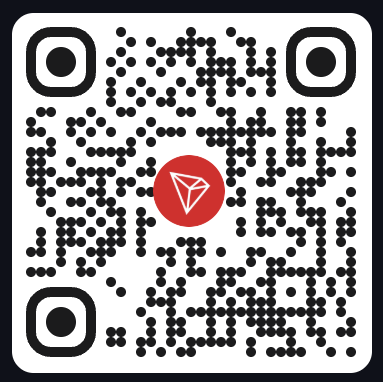
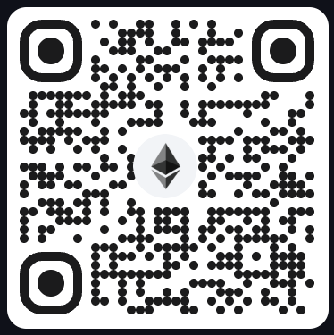
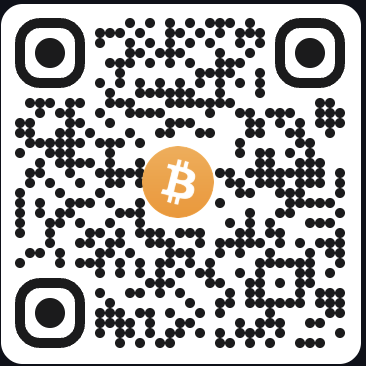

# TwiCast TV

Лёгкий и быстрый клиент Twitch для Android TV: под пульт и под слабые ТВ-приставки.

[English version](README.md)

> TwiCast TV — независимый проект. Он не аффилирован с Twitch Interactive, Inc., не одобрен и не спонсируется ею.
> Twitch — торговая марка Twitch Interactive, Inc.

## Возможности

- **Главная**: каналы из подписок в эфире, «Недавно смотрели», рекомендации по вашим категориям, популярное на
  вашем языке. На карточках видно, сколько идёт эфир. Обновляется сама при возврате и раз в несколько минут на экране.
- **Без входа**: смотреть можно и гостем — популярное, категории, поиск и каналы. Вход нужен только для подписок.
- **Категории** с фильтрами и стримы каждой категории по языку.
- **Поиск** каналов и категорий: экранная клавиатура (раскладки LAT / РУС / УКР), голосовой ввод, недавние запросы
  и каналы.
- **Подписки**: каналы в эфире и офлайн на одном экране; в сайдбаре — счётчик, сколько из них сейчас в эфире.
- **Уведомления о начале эфира**, даже когда TwiCast закрыт: плашка поверх любого приложения, по нажатию открывается
  эфир. Проверка раз в 15 минут, выключается в «Настройки · Система».
- **Страница канала**: эфир, расписание стримов, записи трансляций и популярные клипы. **Подписка и отписка** через QR-код: Twitch не
  даёт сторонним приложениям подписываться, поэтому код сканируется телефоном и Follow нажимается в приложении Twitch.
- **Плеер**: плеер TwiCast (ExoPlayer, быстро запускается и не нагружает слабые приставки) или официальный плеер
  Twitch как запасной вариант. Сверху название стрима, по аватарке открывается канал. Выбор качества, чат рядом с
  видео (только чтение, плавно прокручивается к новым сообщениям), плашка во время рекламы на Twitch, сообщение, когда
  трансляция завершилась. **Перемотка в записях**: ← → по 10 секунд (удерживайте — быстрее), ⏪ ⏩ на
  пульте, полоса прогресса в панели управления; запись продолжается с места, где вы остановились, или «С начала». При сворачивании воспроизведение останавливается и продолжается при
  возврате.
- **Вход с телефона** через device code flow Twitch: QR-код и короткий код, без ввода пароля пультом.
- **Настройки** в трёх разделах: **Плеер** (плеер, качество по умолчанию, чат вместе со стримом), **Система**
  (светлая / тёмная / системная тема, язык интерфейса: Русский, Українська, English), **Оптимизация** (ускорение
  запуска стрима с Twitch player — около 250 МБ памяти; освобождение памяти при сворачивании).
- **Самообновление** из GitHub Releases с экраном «Что нового» за все пропущенные версии, а в сайдбаре — «Что
  нового»: история всех обновлений по датам.

## Установка

Скачайте последний APK из [релизов](https://github.com/RozumS321/TwiCast-TV-releases/releases) и установите на
телевизор, например так:

```bash
adb install twicast-tv-<версия>.apk
```

Нужен Android TV 8.0 (API 26) или новее. Дальше приложение обновляется само.

## Сборка

Нужны JDK 21 и Android SDK (compile SDK 37).

1. Зарегистрируйте приложение в [консоли разработчика Twitch](https://dev.twitch.tv/console/apps): тип клиента
   **Public** (секрет приложению не нужен). OAuth Redirect URL в device code flow не используется, подойдёт любой
   корректный адрес.
2. Скопируйте `local.properties.example` в `local.properties` и впишите `sdk.dir` и `twitch.clientId`.
3. Соберите и установите:

```bash
./gradlew assembleDebug
```

```bash
adb install -r app/build/outputs/apk/debug/app-debug.apk
```

Юнит-тесты:

```bash
./gradlew testDebugUnitTest
```

При входе запрашивается только `user:read:follows`.

## Технологии

Kotlin, Compose for TV, MVVM с одним `StateFlow` состояния на экран, Hilt, Retrofit с kotlinx.serialization, Coil 3,
Media3 ExoPlayer, DataStore, Navigation Compose с типобезопасными маршрутами.

Правила производительности (анимации фокуса и сайдбара только в фазе отрисовки, ключи во всех ленивых списках,
картинки ровно под размер карточки) и требования к коду — в [docs/twicast_tv.md](docs/twicast_tv.md); цвета,
шрифты и размеры — в [docs/DESIGN.md](docs/DESIGN.md).

```
app/src/main/java/app/twicast/tv/
├─ core/        дизайн-система, DI, сеть, профиль устройства, язык
├─ data/        модели, API Twitch, репозитории, обновления
├─ feature/     главная, категории, поиск, подписки, профиль, канал, плеер, вход, настройки, обновления,
│              история обновлений, уведомления
└─ navigation/  оболочка приложения с сайдбаром
```

## Лицензия

[Apache License 2.0](LICENSE).

## Поддержать проект

TwiCast TV бесплатный и без рекламы от себя. Если приложение вам пригодилось, поддержите разработку: каждый донат
мотивирует чаще выпускать обновления, добавлять новые функции и чинить то, что сломалось. Принимаю криптой:

| Сеть | Адрес | QR |
|------|-------|----|
| USDT (сеть Tron, TRC20) | `TGBihhBhECrx2ztCG5avN7icRDvbSofiHM` |  |
| ETH (сеть Ethereum) | `0x5aF3A76Fa56F0dfb77D6ECdc140646437e12278d` |  |
| BTC (сеть Bitcoin) | `bc1q0ff3p0y7mntn7qe90twppskqzhq00akw49rt8n` |  |

Отправляйте на каждый адрес только монеты его сети: перевод в другой сети потеряется. Спасибо!
